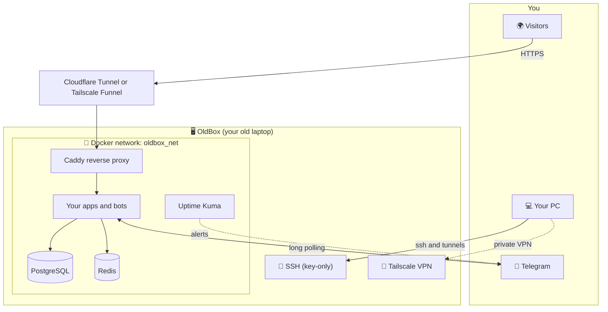

<div align="center">

```
   ███   █      ████   ████    ███   █   █
  █   █  █      █   █  █   █  █   █   █ █
  █   █  █      █   █  ████   █   █    █
  █   █  █      █   █  █   █  █   █   █ █
   ███   █████  ████   ████    ███   █   █
```

### Turn any old laptop into a rock-solid home server — in one command.

Hardened Linux · Docker · databases · Telegram-bot ready · private remote access · nightly backups

<br>


<br>

[Quick start](#-quick-start) ·
[What you get](#-what-you-get) ·
[Options](#-command-line-reference) ·
[Remote access](#-reach-it-from-your-pc) ·
[Go public](#-put-your-apps-on-the-internet) ·
[Troubleshooting](#-troubleshooting)

</div>

---

## Why OldBox?

You have a laptop in a drawer with a dead battery, a cracked hinge, or just a slow CPU. As a **headless server** it is perfect: it has a built-in screen, keyboard and (mostly) a battery, it sips power, and it is fast enough for Telegram bots, web apps, APIs and databases.

Setting one up *properly* is the hard part: lid-close behaviour, SSD wear, SSH lock-outs, firewall vs. Docker, backups, updates, secrets. **OldBox does all of it, safely, and explains each step as it goes.**

| | |
|---|---|
| 🧠 **Interactive or unattended** | Friendly wizard, or `-y` plus flags for scripts and CI |
| 🛡️ **Lock-out proof** | Password SSH is only disabled if a key exists; config is validated first and rolled back on error |
| ♻️ **Idempotent** | Run it 100 times: same result, nothing duplicated |
| ✍️ **Respects your edits** | If you changed a file, OldBox keeps it and writes `file.new` beside it |
| 🌍 **Any mainstream distro** | Debian/Ubuntu, Fedora/RHEL, Arch and openSUSE families |
| 🎨 **Pretty everywhere** | Truecolor → 256 → 16 → plain; Unicode → ASCII; works from 40 to 100+ columns; clean logs when piped |
| 🔍 **Transparent** | `--dry-run` shows everything it *would* do; every change is listed below |

---

## 🚀 Quick start

> [!IMPORTANT]
> Replace `YOUR_USER` below with your GitHub username after you publish the repo.

**1. Install a minimal Linux** on the laptop (Debian 13 or Ubuntu Server LTS recommended). During setup tick **SSH server** and create a normal user.

**2. From your PC, copy your key over** (this is what lets OldBox safely switch to key-only login):

```bash
ssh-copy-id youruser@laptop-ip
ssh youruser@laptop-ip
```

**3. Download, read, run** — always read a script before you run it as root:

```bash
curl -fsSLO https://raw.githubusercontent.com/YOUR_USER/oldbox/main/oldbox.sh
less oldbox.sh                 # have a look first
sudo bash oldbox.sh            # guided install
```

<details>
<summary><b>Prefer a one-liner?</b></summary>

```bash
sudo bash -c "$(curl -fsSL https://raw.githubusercontent.com/YOUR_USER/oldbox/main/oldbox.sh)"
```

The wizard still works (it reads from your terminal). In this mode OldBox cannot copy itself to `/usr/local/bin/oldbox`, so download the file if you want the `oldbox status` / `oldbox update` shortcuts.
</details>

<details>
<summary><b>Fully unattended (scripts, Ansible, cloud-init)</b></summary>

```bash
sudo ADMIN_USER=saad bash oldbox.sh -y \
  --timezone Asia/Kuwait \
  --github-keys YOUR_GITHUB_NAME \
  --with mongo,adminer \
  --tunnel tailscale
```

Environment variables with the same names as the answers work too. Note that `sudo` clears the environment; either put variables on the command line as above, or use `sudo -E`.
</details>

**4. Preview anything first** — nothing is changed in dry-run mode:

```bash
sudo bash oldbox.sh --dry-run
sudo bash oldbox.sh check          # pre-flight checks only
```

---

## 📦 What you get



### The system layer

| Feature | What it does | Why it matters on an old laptop |
|---|---|---|
| **Always-on mode** | Ignores lid close, masks suspend/hibernate | The server stays up with the lid shut |
| **Battery limit** | Caps charging (default 80 %) when the hardware supports it | Dramatically slows battery wear on a machine that is always plugged in |
| **SSD care** | Weekly TRIM, low `vm.swappiness`, capped journal size | Fewer writes, longer SSD life |
| **Auto security updates** | `unattended-upgrades` / `dnf-automatic` | Patches arrive without you |
| **Firewall** | Deny-by-default, SSH rate-limited, your *real* SSH port is detected and kept open | Safe by default, impossible to lock yourself out through the firewall step |
| **SSH hardening** | Key-only login, no root password login, keep-alives | Closes the #1 attack vector |
| **Disk health** | `smartd` monitoring | Know the drive is dying before it dies |
| **Time sync + timezone** | NTP on, timezone set | TLS and logs need correct time |

### The Docker stack (each piece optional)

| Component | Default | Port (on the laptop) | Notes |
|---|:--:|---|---|
| **PostgreSQL 18** | ✅ | `127.0.0.1:5432` | Tuned for small RAM |
| **Redis 8** | ✅ | internal only | Password-protected, memory-capped |
| **Caddy** | ✅ | `8080` / `8443` (80/443 in `direct` mode) | Reverse proxy, automatic HTTPS when you use a domain |
| **Uptime Kuma 2** | ✅ | `127.0.0.1:3001` | Alerts (Telegram, email, …) when a bot or site goes down |
| **Dozzle** | ✅ | `127.0.0.1:8888` | Live container logs in the browser |
| MariaDB (LTS) | – | `127.0.0.1:3306` | For PHP/MySQL apps |
| phpMyAdmin | – | `127.0.0.1:8081` | Auto-enables MariaDB |
| Adminer | – | `127.0.0.1:8082` | One UI for PostgreSQL and MySQL |
| MongoDB 8 | – | `127.0.0.1:27017` | Cache capped at 0.5 GB; **needs an AVX CPU** (checked for you) |
| PHP-FPM | – | via Caddy | Includes `pdo_pgsql`, `pdo_mysql`, `mysqli` |
| Cloudflare Tunnel | – | – | Public access without opening router ports |

**Python, Node.js and PHP are deliberately *not* installed on the host.** Every project ships its own runtime in its container (`python:3-slim`, `node:lts-alpine`, `php:fpm-alpine`), so versions never conflict and nothing pollutes the OS. Ready-to-run **Python and Node Telegram-bot templates** are included.

> [!NOTE]
> **Everything private stays private.** Databases and admin UIs bind to `127.0.0.1` only. You reach them through an SSH tunnel or Tailscale, never the open internet. Docker-published ports bypass host firewalls by design, so this binding is the real protection.

<details>
<summary><b>Approximate memory use (idle) and the limits OldBox sets</b></summary>

Typical idle figures; measure your own with `docker stats`.

| Service | Typical idle | `mem_limit` |
|---|---|---|
| PostgreSQL | 100–250 MB | 1 GB |
| Redis | 10–40 MB | 384 MB |
| Caddy | 30–50 MB | 192 MB |
| Uptime Kuma | 150–300 MB | 768 MB |
| Dozzle | 20–40 MB | 128 MB |
| MariaDB | 150–300 MB | 768 MB |
| MongoDB | 300–600 MB | 1 GB |
| phpMyAdmin / Adminer | 20–50 MB | 256 MB / 128 MB |
| Each Telegram bot | 30–80 MB | 128 MB (template) |

Limits stop one runaway container from freezing the whole laptop. The default stack fits comfortably in 4 GB of RAM.
</details>

---

## 🖥️ Supported systems

| Family | Distros | Status |
|---|---|---|
| **Debian** | Debian 12/13, Ubuntu 22.04+, Linux Mint, Pop!_OS, Raspberry Pi OS (64-bit) | 🟢 Primary target |
| **Fedora / RHEL** | Fedora, Rocky, AlmaLinux, CentOS Stream | 🟡 Best effort |
| **Arch** | Arch, Manjaro, EndeavourOS | 🟡 Best effort |
| **openSUSE** | Leap, Tumbleweed | 🟡 Best effort |

Requirements: **64-bit**, **systemd**, 2 GB RAM (4 GB+ recommended), ~10 GB free disk, internet. Containers without systemd and WSL1 are not supported.

> [!NOTE]
> **Project status.** `v1.0.0` is linted with ShellCheck, exercised with dry runs and wizard walkthroughs at multiple terminal sizes, and its generated files (compose, Caddyfile, bots, backup job) are validated. Reports from real hardware on the 🟡 families are very welcome: please open an issue with the contents of `/var/log/oldbox.log`.

Differences per family are handled automatically: package manager, package names, firewall (`ufw` on Debian/Arch, `firewalld` on Fedora/openSUSE), Docker's official repository with a distro-package fallback, SELinux volume labels, and SSH drop-in support. Automatic updates are enabled on Debian-family and RHEL-family systems and intentionally skipped on rolling distros.

---

## 🧭 The guided install

```
   ███   █      ████   ████    ███   █   █
  ...
  Pre-flight checks
  ────────────────────────────────────────────
  ✔ System           Debian GNU/Linux 13  [debian family]
  ✔ Privileges       running as root
  ✔ Architecture     x86_64 (64-bit)
  ⚠ Memory           3995 MB RAM: fine for a lean stack
  ✔ Internet         download.docker.com reachable
  ...
› ████████████░░░░░░░░░░░░ 8/16  Docker Engine and Compose
  ⠹ Installing Docker Engine + Compose (official packages) 14s
```

1. **Basics** — admin user, timezone, install folder.
2. **Component menu** — type numbers to toggle, `a` for all, `n` for none.
3. **Remote access** — how (or whether) the internet reaches your web apps.
4. **SSH keys** — optionally import yours from `github.com/<you>.keys`.
5. **Pre-flight checks** — OS, systemd, architecture, RAM, disk, internet, Wi-Fi, port conflicts, MongoDB's AVX requirement. Failures stop the run *before* anything changes.
6. **Plan + confirmation** — you see exactly what will be installed.
7. **Execution** — animated spinner, progress bar, per-step timing. Failures show the last lines of that command's own output and where the full log is.

Your answers are remembered in `/var/lib/oldbox/answers.env` (never secrets), so re-running offers the same defaults.

**Terminal behaviour:** truecolor gradient banner → 256 colours → 8 colours → plain text when `NO_COLOR` is set or output is piped. UTF-8 glyphs fall back to ASCII on the Linux console or with `--ascii`. Layout adapts to the terminal width live (40–100 columns). Add `--no-anim` for a static log-style output.

---

## ⌨️ Command-line reference

```text
sudo bash oldbox.sh [command] [options]
```

### Commands

| Command | What it does |
|---|---|
| `install` *(default)* | Full setup. Safe to re-run any time. |
| `check` | Pre-flight checks and plan only; changes nothing. |
| `status` | Health dashboard: load, memory, disk, temperature, battery, Tailscale, containers. |
| `update` | Pull newer container images and recreate only what changed. |
| `backup` | Run the nightly backup job right now. |
| `help` | Show usage. |

After the first install, the same script is available everywhere as `oldbox` (e.g. `oldbox status`).

### Options

| Option | Meaning |
|---|---|
| `-y`, `--yes` | Non-interactive: accept defaults and flags |
| `-n`, `--dry-run` | Show what would happen; change nothing |
| `--user NAME` | Admin account that owns Docker access and SSH keys |
| `--timezone TZ` | e.g. `Asia/Kuwait`, `Europe/Paris` |
| `--stack-dir DIR` | Where the Docker stack lives (default `/opt/oldbox`) |
| `--with a,b,c` / `--without a,b,c` | Enable / disable components (or `all`) |
| `--tunnel MODE` | `none` · `lan` · `tailscale` · `cloudflare` · `direct` |
| `--domain NAME` | Your domain (`direct` / `cloudflare`) |
| `--email ADDR` | Let's Encrypt email (`direct`) |
| `--github-keys USER` | Import SSH keys from `github.com/USER.keys` |
| `--skip-upgrade` | Don't upgrade OS packages first |
| `--no-color` `--no-anim` `--ascii` | Plain output for unusual terminals |
| `-V`, `--version` · `-h`, `--help` | Version / help |

**Component names:** `postgres redis mariadb mongo caddy kuma dozzle adminer phpmyadmin php tailscale cockpit backups smart templates power battery ssd updates firewall ssh`

### Environment variables

Same names work as environment variables: `ADMIN_USER`, `TIMEZONE`, `STACK_DIR`, `TUNNEL_MODE`, `DOMAIN`, `ACME_EMAIL`, `GITHUB_KEYS_USER`, `SSH_PUBKEY`, `CF_TUNNEL_TOKEN`, `BATTERY_LIMIT` (50–100), `SWAPPINESS`, `JOURNAL_MAX`, `BACKUP_KEEP_DAYS`, `BACKUP_TIME` (`HH:MM`), `BACKUP_REMOTE` (`user@host:/path`), `ADMIN_BIND`, `WEB_HTTP_PORT`, `DO_UPGRADE`, and `WITH_<COMPONENT>=yes|no` (e.g. `WITH_MONGO=yes`).

Precedence: **flags > environment > saved answers > defaults**.

### Exit codes

`0` success · `1` fatal error (message + hint printed) · `2` bad usage · `130` interrupted (always safe to re-run).

---

## 🔌 Reach it from your PC

### SSH, the easy way

Add to `~/.ssh/config` on your PC:

```sshconfig
Host oldbox
    HostName 192.168.1.50        # or its Tailscale name
    User youruser
    # Open the admin UIs automatically on every connection:
    LocalForward 3001 127.0.0.1:3001   # Uptime Kuma
    LocalForward 8888 127.0.0.1:8888   # Dozzle (logs)
    LocalForward 8082 127.0.0.1:8082   # Adminer
    LocalForward 5432 127.0.0.1:5432   # PostgreSQL for local tools
```

Now `ssh oldbox` connects, and `http://localhost:3001` on your PC opens Uptime Kuma.

> [!TIP]
> **VS Code:** install the *Remote - SSH* extension, press `F1` → *Remote-SSH: Connect to Host* → `oldbox`. You edit files and run terminals on the laptop as if they were local.

### Away from home: Tailscale

```bash
sudo tailscale up        # prints a link; open it and log in
```

Install Tailscale on your PC/phone too, then use the laptop's Tailscale name or `100.x` address in place of the LAN IP: no router changes, works behind any NAT.

### Where your files live

```
/opt/oldbox/
├── compose.yaml        the stack (edit freely)
├── .env                secrets + settings (mode 600)
├── caddy/Caddyfile     routing (edit freely)
├── sites/              static + PHP sites
└── bots/
    ├── python-example/ ready-to-run Telegram bot
    └── node-example/   ready-to-run Telegram bot
```

Useful everyday commands:

```bash
cd /opt/oldbox
docker compose ps                      # what's running
docker compose logs -f postgres        # follow one service
docker compose up -d                   # apply edits
oldbox status                          # health at a glance
```

---

## 🌍 Put your apps on the internet

Telegram bots need **nothing** here: they only make outgoing connections. This section is for *web* apps.

| Mode (`--tunnel`) | Cost | Needs a domain | Router changes | Best for |
|---|---|:--:|:--:|---|
| `none` | free | – | none | Private use via Tailscale / SSH tunnels |
| `lan` | free | – | none | Reach apps from your home network |
| `tailscale` | free | no | none | Quick public HTTPS on a `*.ts.net` address |
| `cloudflare` | free tunnel | **yes** (you buy it) | none | Real sites on your own domain |
| `direct` | free | **yes** | port-forward 80/443 | Classic self-hosting |

### Tailscale Funnel (free, no domain)

```bash
sudo bash oldbox.sh --tunnel tailscale
sudo tailscale up
sudo tailscale funnel --bg 8080
```

You get a public `https://<machine>.<tailnet>.ts.net` address. Funnel has its own rules (allowed ports, one hostname per machine, bandwidth limits); if the command asks you to enable something in the Tailscale admin console, follow its prompt. See Tailscale's Funnel docs.

### Cloudflare Tunnel (your domain, no open ports)

1. Add your domain to Cloudflare (a domain costs a few dollars a year; the tunnel itself is free).
2. *Zero Trust → Networks → Tunnels → Create a tunnel* and copy the **token**.
3. Install:
   ```bash
   sudo CF_TUNNEL_TOKEN='eyJ...' bash oldbox.sh --tunnel cloudflare --domain example.com
   ```
4. In the Cloudflare dashboard add a **public hostname** (e.g. `app.example.com`) pointing to `http://caddy:80`.
5. Add a matching block to `/opt/oldbox/caddy/Caddyfile` (see below).

### Direct (port-forwarding)

```bash
sudo bash oldbox.sh --tunnel direct --domain example.com --email you@example.com
```

Forward router ports **80 and 443** to the laptop, point your domain's DNS at your home IP, and Caddy obtains and renews HTTPS certificates automatically. Some ISPs block inbound ports or use CGNAT; in that case use a tunnel.

> [!NOTE]
> **About ngrok:** its free plan is built for development and has tight monthly limits and a browser interstitial page (check ngrok's pricing page for current numbers). For hosting, Tailscale Funnel or Cloudflare Tunnel are better fits.

---

## 🤖 Deploy a Telegram bot

```bash
cd /opt/oldbox/bots/python-example     # or node-example
cp .env.example .env && nano .env      # paste the token from @BotFather
docker compose up -d --build
docker compose logs -f
```

Send `/ping` to your bot: it answers `pong`. Both templates use **long polling** (no open ports), handle `SIGTERM` gracefully, run as a non-root user, have a 128 MB memory limit and rotated logs.

**Make your own:** copy a template folder, replace `bot.py` / `bot.js`. Because every bot joins the shared `oldbox_net` network, it can reach the databases by name:

```text
postgresql://postgres:<password>@postgres:5432/postgres
redis://:<password>@redis:6379/0
```

Passwords are in `/opt/oldbox/.env` (`POSTGRES_PASSWORD`, `REDIS_PASSWORD`). Create a dedicated database user per app rather than using the superuser everywhere.

---

## 🌐 Add a web app behind Caddy

Create `/opt/oldbox/apps/myapp/compose.yaml`:

```yaml
name: myapp
services:
  web:
    build: .
    restart: unless-stopped
    mem_limit: 256m
    networks: [oldbox]
networks:
  oldbox:
    name: oldbox_net
    external: true
```

Route it in `/opt/oldbox/caddy/Caddyfile`:

```caddyfile
http://app.example.com {
    reverse_proxy web:3000
}
```

Apply:

```bash
cd /opt/oldbox/apps/myapp && docker compose up -d --build
docker compose -f /opt/oldbox/compose.yaml exec caddy caddy reload --config /etc/caddy/Caddyfile
```

*(In `direct` mode, use `app.example.com { ... }` without `http://` so Caddy handles HTTPS.)*

---

## 💾 Backups

A systemd timer (default **03:30**, ±10 min) runs `/usr/local/sbin/oldbox-backup` and stores dated folders in `/var/backups/oldbox` (default 7 days kept). Each run saves:

| Item | File |
|---|---|
| PostgreSQL (all databases + roles) | `postgres.sql.gz` |
| MariaDB | `mariadb.sql.gz` |
| MongoDB | `mongo.archive.gz` |
| Redis snapshot | `redis-dump.rdb` |
| Uptime Kuma data | `uptime-kuma-data.tgz` |
| Stack config (**includes `.env` secrets**) | `stack-config.tgz` |

```bash
oldbox backup                          # run now
systemctl list-timers oldbox-backup    # next run
journalctl -t oldbox-backup            # history
```

> [!WARNING]
> **A backup that lives on the same disk is not a backup.** Set `BACKUP_REMOTE=user@other-host:/path` (rsync over SSH) or copy `/var/backups/oldbox` to another machine or cloud storage. Backups contain your secrets: keep them private.

<details>
<summary><b>Restoring</b></summary>

```bash
cd /opt/oldbox
# PostgreSQL
gunzip -c /var/backups/oldbox/<date>/postgres.sql.gz | docker compose exec -T postgres psql -U postgres
# MariaDB
gunzip -c .../mariadb.sql.gz | docker compose exec -T mariadb sh -c 'mariadb -uroot -p"$MARIADB_ROOT_PASSWORD"'
# MongoDB
docker compose exec -T mongo sh -c 'mongorestore --archive --gzip -u root -p "$MONGO_INITDB_ROOT_PASSWORD" --authenticationDatabase admin' < .../mongo.archive.gz
# Redis: stop redis, put dump.rdb into its data volume, start again
# Stack config
tar xzf .../stack-config.tgz -C /opt/oldbox
```

Test a restore once, before you need it.
</details>

---

## 📈 Monitoring and updates

* **Uptime Kuma** (`http://localhost:3001` through your tunnel): add monitors for your sites and bots. For Telegram alerts: *Settings → Notifications → Telegram*, paste a bot token and your chat ID.
* **Dozzle** (`http://localhost:8888`): live logs for every container.
* **`oldbox status`**: load, RAM, disk, temperature, battery and container health in one screen.
* **Disk health:** `smartd` watches the drive; check manually with `sudo smartctl -a /dev/sda` (or `/dev/nvme0`).

**Updating**

```bash
oldbox update            # newer images, recreates only what changed
```

OS security patches install automatically on Debian- and RHEL-family systems. Images use major-version tags (`postgres:18`, `uptime-kuma:2`, `caddy:2`, …) so `oldbox update` gives you patch releases without surprise major jumps. To pin exact versions, set image overrides in `.env`:

```dotenv
POSTGRES_IMAGE=postgres:18.1
KUMA_IMAGE=louislam/uptime-kuma:2.1.1
```

> [!WARNING]
> **Major database upgrades** (e.g. PostgreSQL 18 → 19) are never automatic. Dump, upgrade, restore. Note that PostgreSQL 18+ images store data under `/var/lib/postgresql`, while 17 and older used `/var/lib/postgresql/data`; OldBox's compose file uses the 18+ layout.

---

## 🔒 Security model

**What OldBox does**
* Key-only SSH, `PermitRootLogin no`, `MaxAuthTries 3`, keep-alives, validated with `sshd -t` and verified in the *effective* config (`sshd -T`) afterwards.
* Deny-by-default firewall with SSH rate-limiting; your actual SSH port(s), including the one of your current session, are allowed first.
* Databases, admin UIs and Postgres bind to `127.0.0.1`; secrets are random 48-hex-character strings in a `600` file; containers use `no-new-privileges`, memory limits and rotated logs.
* Automatic security updates.

**What you should know**
* Membership of the **`docker` group is root-equivalent**. Only add people you trust.
* **Dozzle mounts the Docker socket** (read-only) to read logs. It is bound to localhost, but treat access to it as sensitive; remove the component if you don't need it.
* Docker's published ports **bypass `ufw`/`firewalld`**. Keep `127.0.0.1:` in front of anything private.
* `ufw limit` can briefly block an IP that opens many SSH connections in 30 seconds.
* If you connect as `root` over SSH while running OldBox, root login is kept possible with keys only so you are not locked out.

Found a security issue? Please report it privately (see [Contributing](#-contributing)).

---

## 🧾 Exactly what OldBox changes

<details>
<summary><b>Full list of files and services touched</b></summary>

| Area | Path / unit |
|---|---|
| Lid / sleep | `/etc/systemd/logind.conf.d/00-oldbox-lid.conf`, masks `sleep/suspend/hibernate/hybrid-sleep.target` |
| Battery limit | `/etc/systemd/system/oldbox-battery.service` |
| SSD + memory | `fstrim.timer`, `/etc/sysctl.d/99-oldbox.conf`, `/etc/systemd/journald.conf.d/00-oldbox.conf` |
| Auto updates | `/etc/apt/apt.conf.d/20auto-upgrades` or `/etc/dnf/automatic.conf` |
| Docker | `/etc/apt/sources.list.d/docker.list` + `/etc/apt/keyrings/docker.asc` (or `/etc/yum.repos.d/docker-ce.repo`), `/etc/docker/daemon.json` (merged, never replaced; backup `.oldbox.bak`) |
| SSH | `/etc/ssh/sshd_config.d/00-oldbox.conf` (+ an `Include` line in `sshd_config` if missing; backup `.oldbox.bak`), `~/.ssh/authorized_keys` (append only) |
| Firewall | `ufw` or `firewalld` rules |
| Backups | `/etc/oldbox/backup.conf`, `/usr/local/sbin/oldbox-backup`, `oldbox-backup.service` / `.timer`, `/var/backups/oldbox` |
| State | `/var/lib/oldbox/{answers,state}.env`, `/var/log/oldbox.log`, `/usr/local/bin/oldbox` |
| Stack | `/opt/oldbox` (or `--stack-dir`), Docker network `oldbox_net` |

Everything is ordinary, inspectable configuration: no kernel modules, no daemons of its own.
</details>

<details>
<summary><b>Reverting</b></summary>

```bash
# Allow password SSH again
sudo rm /etc/ssh/sshd_config.d/00-oldbox.conf && sudo systemctl reload ssh   # or sshd

# Let the laptop sleep again
sudo rm /etc/systemd/logind.conf.d/00-oldbox-lid.conf
sudo systemctl unmask sleep.target suspend.target hibernate.target hybrid-sleep.target

# Firewall off
sudo ufw disable            # or: sudo systemctl disable --now firewalld

# Remove the battery limit and backup job
sudo systemctl disable --now oldbox-battery.service oldbox-backup.timer

# Stop the stack (keeps data)            ...or add -v to DELETE the data volumes
cd /opt/oldbox && docker compose down
```
</details>

---

## 🛠️ Troubleshooting

| Symptom | Likely cause → fix |
|---|---|
| `Permission denied` running `./oldbox.sh` | Not executable → `chmod +x oldbox.sh`, or run `sudo bash oldbox.sh` |
| `User 'x' does not exist` | Create one: `adduser x` (others: `useradd -m -G wheel x`) and pass `--user x` |
| Pre-flight: *Internet* fails | Check cable/Wi-Fi, DNS (`/etc/resolv.conf`), proxy; `curl -I https://download.docker.com` |
| Pre-flight: *systemd* fails | You're in a container/WSL1; use a VM, bare metal or WSL2 with systemd |
| SSH step says *password login stays ON* | No key for the admin user. Run `ssh-copy-id` from your PC (or `--github-keys NAME`) and re-run |
| Locked out after closing the lid | Re-run OldBox (always-on mode) and reboot once; check BIOS "lid close" options |
| `docker: permission denied` | Log out and back in once (new `docker` group) |
| MongoDB disabled by pre-flight | CPU has no AVX; use PostgreSQL's JSONB or an older Mongo image you pin yourself |
| Caddy fails to bind | Another service uses the port (shown in pre-flight); change `--tunnel`/`WEB_HTTP_PORT` or stop that service |
| Can't open Uptime Kuma from my PC | Admin UIs are localhost-only by design; use the `ssh -L` tunnel shown at the end of the install |
| A service is unhealthy | `docker compose -f /opt/oldbox/compose.yaml logs --tail 50 <service>` |
| Cloudflare tunnel shows *down* | Token wrong/expired, or the public hostname doesn't point to `http://caddy:80` |
| "Kept your edits … saved as `*.new`" | Intentional: you changed that file. Diff it (`diff file file.new`) and merge what you want |
| Anything else | Read `/var/log/oldbox.log`: every command and its output is recorded (secrets are never passed on command lines) |

---

## ❓ FAQ

<details><summary><b>Is it safe to run twice? Or after I edited things?</b></summary>
Yes. Each step checks current state; generated files you changed are left alone (new version beside it as <code>*.new</code>); secrets are generated once and never rotated; Docker config is merged, not replaced.
</details>

<details><summary><b>Why not install Python/Node/PHP/Nginx directly?</b></summary>
Containers keep each project's runtime isolated and disposable: no version clashes, trivial rollback, a clean host. Caddy replaces Nginx for most home-server needs (automatic HTTPS, tiny config). You can still run Nginx in a container if you prefer it.
</details>

<details><summary><b>Do I need a domain?</b></summary>
Not for bots, LAN or private use, and not for Tailscale Funnel. A domain is only needed for Cloudflare Tunnel or direct hosting.
</details>

<details><summary><b>Will it work on a really old/slow laptop?</b></summary>
If it is 64-bit with 2 GB RAM or more, yes: keep to PostgreSQL/Redis plus your bots. Skip MongoDB/MariaDB on low RAM. 32-bit CPUs are not supported (Docker needs 64-bit).
</details>

<details><summary><b>Wi-Fi or Ethernet?</b></summary>
Ethernet if at all possible. Pre-flight warns when the default route is wireless.
</details>

<details><summary><b>Can I add Mongo/Adminer/PHP later?</b></summary>
Yes: <code>sudo bash oldbox.sh --with mongo,adminer</code>. Existing data and secrets are untouched.
</details>

---

## 🧪 Development

```bash
shellcheck oldbox.sh                         # must stay clean
bash -n oldbox.sh                            # syntax
sudo bash oldbox.sh --dry-run -y --user "$USER"
```

Handy test matrix: run dry-runs at different widths (`stty cols 42`), with `NO_COLOR=1`, `--ascii`, and piped (`| cat`) to check every rendering path.

**Design rules for contributions**
1. Every mutation goes through `run`, `run_opt`, `quiet` or `write_managed`, so `--dry-run` stays truthful.
2. Never overwrite a file the user may have edited: use `write_managed`.
3. Anything that can lock someone out (SSH, firewall) must validate first and roll back.
4. No secrets on command lines or in logs.
5. Keep ShellCheck clean; keep output readable at 40 columns.

## 🤝 Contributing

Issues and pull requests are welcome, especially **test reports for Fedora/RHEL, Arch and openSUSE**. When opening an issue include: distro and version, the command you ran, and the tail of `/var/log/oldbox.log`. For security issues, please use GitHub's private vulnerability reporting rather than a public issue.

## 🗺️ Roadmap

- [ ] Optional Wake-on-LAN and UPS (NUT) support
- [ ] Optional Restic backups to S3/B2
- [ ] `oldbox uninstall`
- [ ] Arabic and other translations of the wizard
- [ ] Alpine / OpenRC support

## 📄 License

MIT. See `LICENSE`. Add one to the repository before publishing.

<div align="center">

<sub>Built for old hardware that still has plenty of life in it. If OldBox saved a laptop from the drawer, consider giving the repo a ⭐</sub>

</div>
